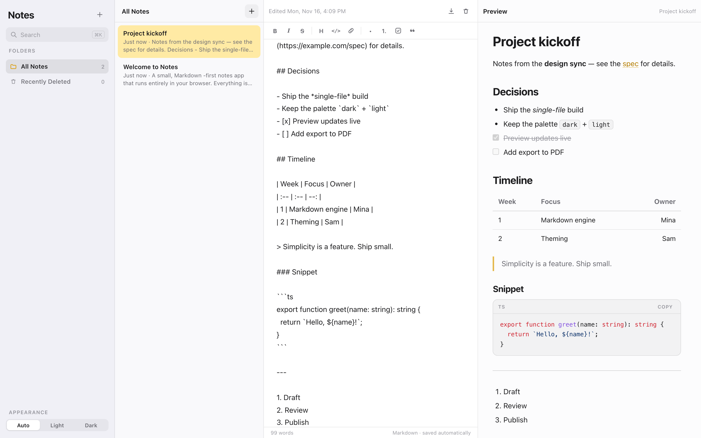
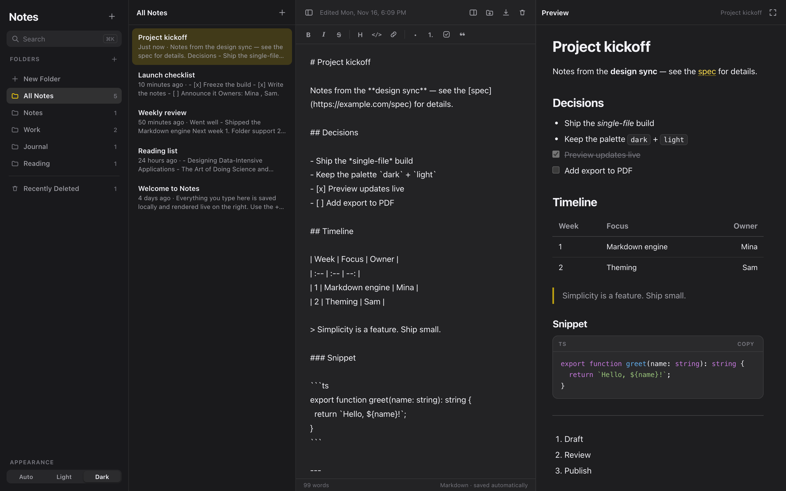
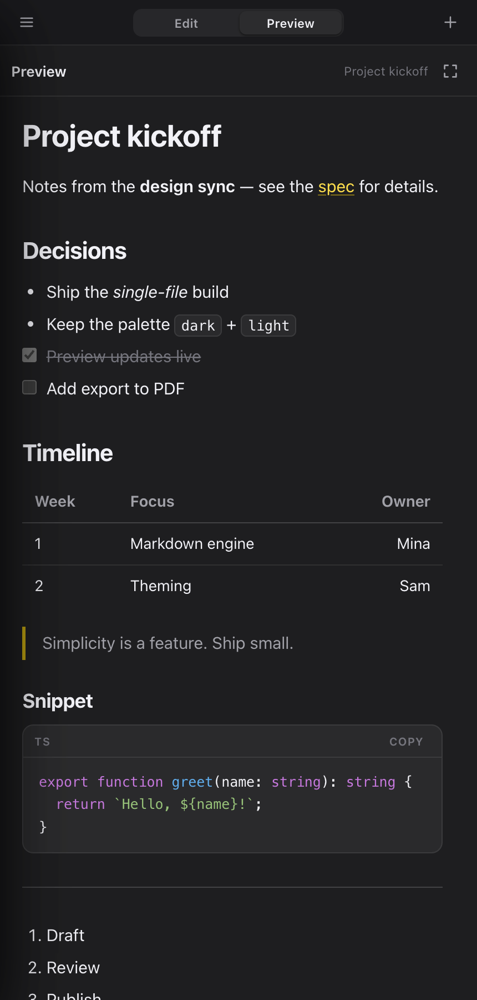
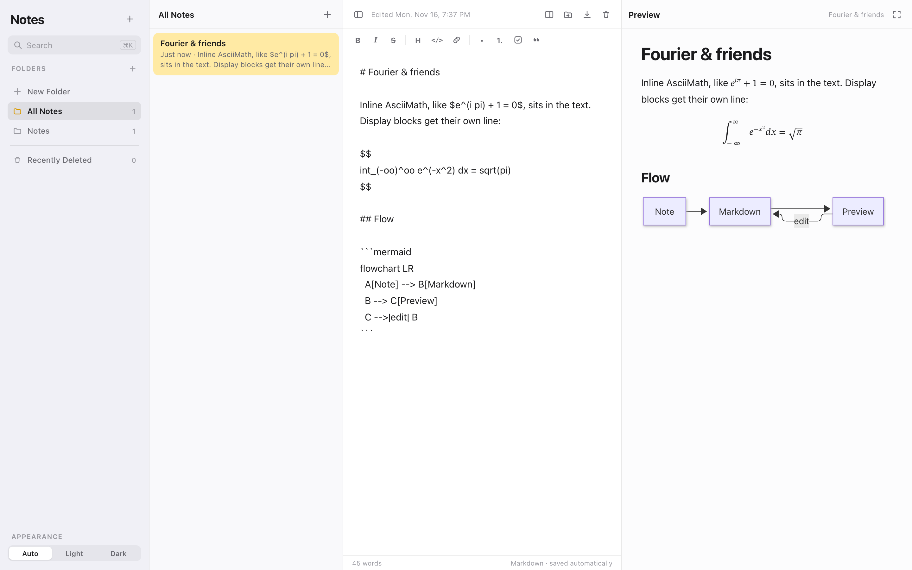
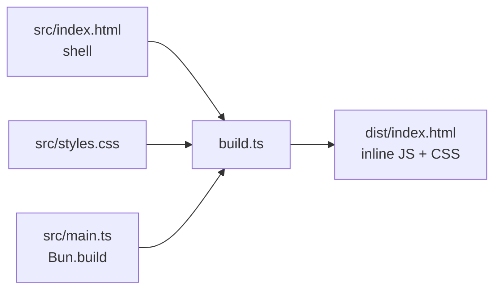
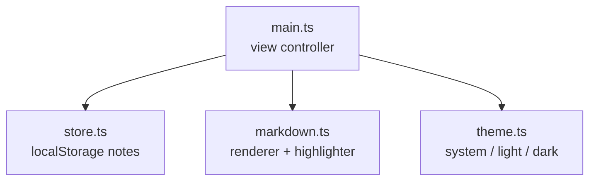

# Notes

An Apple Notes–inspired, Markdown-first notes app. Type in the middle pane and the
rendered note updates in the right pane as you go. Everything is stored locally, and
the whole app compiles down to **one self-contained `index.html`** — no CDN, no fonts
to fetch, no server.



## Quick start

```sh
bun install
bun run build      # writes dist/index.html
```

Open `dist/index.html` directly in a browser — that single file is the entire app.

For development:

```sh
bun run dev        # http://localhost:4173, rebuilds on every reload
bun run build --dev # unminified build, easier to read
bun test           # Markdown + store unit tests
bun run typecheck  # tsc --noEmit
```

## Features

- **Four panes, one window** — folders sidebar, notes list, Markdown source, live preview.
- **Folders** — create, rename, delete and move notes between them; deleting a folder
  sends its notes to Recently Deleted rather than destroying them.
- **Math** — AsciiMath inline (`$...$`), display blocks (`$$...$$`) and fenced `asciimath`
  blocks, rendered as native MathML — no web fonts, and the maths inherits the note's colour.
- **Diagrams** — fenced `mermaid` blocks rendered by the bundled Mermaid (flowcharts,
  sequence, class, state, ER, gantt, pie and the rest), themed to match and cached so
  typing elsewhere does not re-render them.
- **Preview on your terms** — hide the preview pane when you only want to write
  (`⌘\`, remembered across reloads), or expand it into a distraction-free full-screen
  reader (`⌘⇧P`, `Esc` to exit).
- **Layout toggles** — the folders sidebar and notes list can be hidden too (`⌘⇧\`), so the
  editor and preview can take the whole window; each toggle's state is remembered.
- **Live preview** rendered on every keystroke, with proportional scroll sync from the
  editor to the preview.
- **Themes** — Auto (follows the OS via `prefers-color-scheme`), Light, Dark. The theme
  is applied before first paint, so there is no flash of the wrong colours.
- **Local-first storage** — notes are persisted to `localStorage` with a debounced
  write, plus a flush on tab close/hide.
- **Recently Deleted** — soft delete, restore, delete forever, empty trash.
- **Search** across all note text, plus a formatting toolbar, list auto-continuation,
  word count, and Markdown file export. Searching looks across every folder, while
  browsing stays inside the folder you picked.
- **Responsive** — at narrower widths the folders become a drawer, and on phones the
  editor and preview become Edit/Preview tabs.
- **No runtime dependencies** — the Markdown renderer, highlighter, AsciiMath and Mermaid
  are all inlined, so the built file makes no network requests at all.

<p align="center">
  
  
</p>

<p align="center">
  
</p>

## Folder basics

- **Create** — click `+` next to *Folders* or the **New Folder** row at the top of the list,
  type a name, press `Enter`.
- **Rename / delete** — hover a folder row for its pencil and trash buttons. Deleting asks for
  confirmation and moves that folder's notes to Recently Deleted.
- **Move a note** — open the folder button above the editor and pick a destination. The note
  moves there and the app switches to that folder.
- **All Notes** is a smart view across every folder; **Recently Deleted** is the trash.
- New notes are created in the folder you are currently viewing (or the first folder from
  *All Notes*). Folders are flat — there is no nesting.
- **Empty folders** — opening one gives you a blank editor. Just start typing: the note is
  created in that folder, no button press needed.

## Math and diagrams

**AsciiMath** ([asciimath.org](https://asciimath.org/)):

| Syntax | Result |
| --- | --- |
| `$sum_(i=1)^n i$` | inline math |
| `$$ ... $$` | display math (one line or several) |
| a fenced block tagged `asciimath` | display math |
| `\$5` | a literal dollar sign |

Expressions are converted to Presentation MathML, so they need no fonts or stylesheets and
follow the text colour. Malformed expressions fall back to showing the source.

**Mermaid** ([mermaid.js.org](https://mermaid.js.org/)):

- Write a fenced block tagged `mermaid`.
- Diagrams keep their natural size and are only scaled down when they do not fit the
  pane; flowchart nodes hug their labels (Mermaid's default 120 px minimum node width made
  small charts unnecessarily massive).
- Diagrams render a moment after you stop typing (200 ms) and are cached per theme, so
  editing text elsewhere never re-renders an unchanged diagram.
- Invalid diagrams show Mermaid's error message inline instead of breaking the preview.
- `securityLevel: "strict"` is used, so labels are sanitised.



## Keyboard shortcuts

| Shortcut | Action |
| --- | --- |
| `Alt+N` | New note |
| `⌘K` / `Ctrl+K` | Focus search |
| `⌘B` / `Ctrl+B` | Bold |
| `⌘I` / `Ctrl+I` | Italic |
| `⌘\` / `Ctrl+\` | Show / hide the preview pane |
| `⌘⇧\` / `Ctrl+Shift+\` | Show / hide the folders sidebar and notes list |
| `⌘⇧P` / `Ctrl+Shift+P` | Full-screen preview |
| `Tab` | Indent by two spaces |
| `Enter` | Continue the current list (empty item exits the list) |
| `Esc` | Exit full-screen preview, clear search, close popovers and drawers |

## Markdown support

Headings (ATX and setext), bold/italic/strikethrough, inline code, fenced code blocks
with lightweight highlighting for JS/TS, JSON, CSS, HTML, Python, shell, SQL, Go, Rust,
Java and more, links, images, autolinks, bare URLs, blockquotes, nested ordered and
bullet lists, task lists, tables with alignment, horizontal rules, AsciiMath and Mermaid.

Deliberate choices:

- **Raw HTML is escaped**, never injected — a note can't execute scripts.
- **Single newlines become line breaks**, which is what you expect when writing notes.
- Checkboxes in the preview are read-only; edit the `[x]` / `[ ]` in the source.

## How it is built





`build.ts` bundles `src/main.ts` with `Bun.build`, then substitutes the resulting
JavaScript and `src/styles.css` into the `/*__CSS__*/` and `/*__JS__*/` placeholders in
`src/index.html`. The favicon (`src/favicon.svg`) is inlined as a `data:` URI, so the page
never requests a separate icon file. Closing `</script>` sequences are escaped so the
inline bundle can never terminate its own tag.

Mermaid's official UMD build is inlined separately through the `/*__MERMAID__*/`
placeholder, *after* the app script. Two reasons: bundling Mermaid's ESM build with Bun
produces a bundle that hangs in Chromium, and running the app script first keeps
ASCIIMathML's one-shot document scan from walking the 5 MB Mermaid source.

Mermaid dominates the output size:

| Command | Output |
| --- | --- |
| `bun run build` | ~5.5 MB, diagrams included |
| `bun run build --no-mermaid` | ~107 kB, diagram blocks show an explanatory error |

```
src/
  index.html   layout + inline theme bootstrap
  favicon.svg  app icon, inlined by build.ts as a data URI
  styles.css   design tokens (light/dark) + all UI styles
  main.ts      editor, list, folders, preview modes, search, trash, shortcuts
  markdown.ts  dependency-free Markdown renderer with highlighting
  math.ts      AsciiMath → MathML (via the asciimath package)
  diagrams.ts  Mermaid wrapper: theme setup and async rendering
  store.ts     notes + folders, ordering, migration, debounced persistence
  theme.ts     theme mode resolution and system sync
tests/
  markdown.test.ts
  store.test.ts
```

## Notes and limitations

- Storage is per browser profile and per origin. Opening `dist/index.html` from disk
  (`file://`) and from a local server are different origins, so they keep separate notes.
  Snapshots from earlier versions (before folders existed) are migrated automatically into
  a default “Notes” folder.
- No sync, accounts, or encryption — notes live unencrypted in `localStorage`.
- Mermaid is ~5 MB of the build. `bun run build --no-mermaid` keeps the file small and
  shows an explanatory error in place of diagrams.
- Math is AsciiMath, not LaTeX (ASCIIMathML understands a small amount of TeX syntax).
- Undo history is whatever the browser keeps for the textarea; toolbar actions that
  rewrite the buffer may not be undoable.
